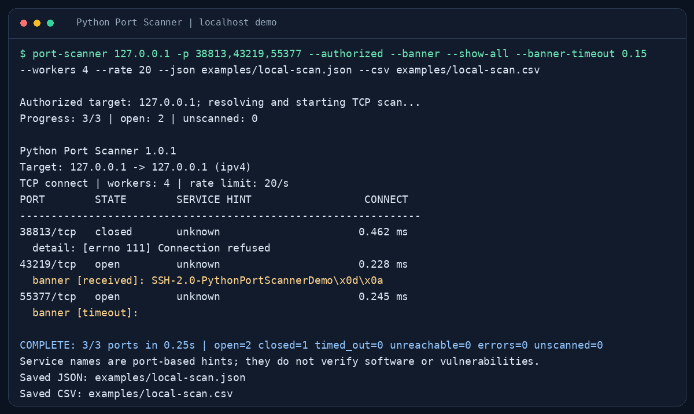
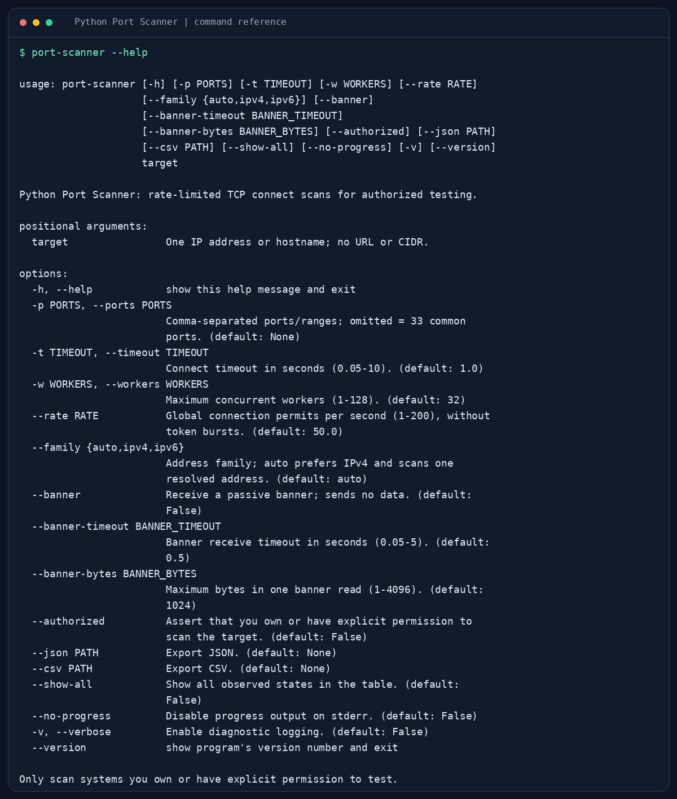

# Python Port Scanner

A concurrent TCP port scanner for authorised security testing, built to demonstrate Python socket programming, multithreading, and network diagnostics.

Scan one IP address or hostname, check common or custom ports, collect optional passive banners, and export results to JSON and CSV. The application uses Python's standard library and has no third-party runtime dependencies.



The image shows actual output from the included localhost demo. Port numbers and timings vary between runs.

## Features

- IPv4, IPv6, and hostname support, with one selected address per scan.
- 33 common TCP ports by default, plus custom lists and inclusive ranges.
- Concurrent scanning using `ThreadPoolExecutor`, with configurable worker and rate limits.
- Explicit ownership or permission confirmation before DNS resolution or scanning.
- Port-based service hints from a curated mapping and the operating system's services database.
- Optional receive-only banner collection with separate time and size limits.
- Progress reporting, readable terminal output, and optional diagnostic logging.
- Separate open, closed, timed-out, unreachable, and error outcomes.
- JSON and CSV exports, including partial results after interruption.
- Unit tests and integration tests using real localhost services.

## Requirements

- Python **3.11 or newer**.
- Windows, macOS, or Linux.
- Ownership of, or explicit permission to test, the target system.

Normal TCP connect scans do not require administrator or root privileges.

## Installation

Open a terminal in the project folder containing `pyproject.toml`.

### Windows PowerShell

These commands use an installed Python 3.14. If you use another supported version, adjust `-3.14` to match. Skip environment creation if your working `.venv314` already exists.

```powershell
py -3.14 -m venv .venv314
.\.venv314\Scripts\Activate.ps1
python --version
python -m pip install .
port-scanner --help
```

Check that `python --version` shows **3.11 or newer**. The final dot in `pip install .` means the current project folder.

If PowerShell blocks activation, use the environment's Python directly:

```powershell
.\.venv314\Scripts\python.exe -m pip install .
.\.venv314\Scripts\python.exe -m port_scanner --help
```

When using this method, replace `port-scanner` in the examples below with `.\.venv314\Scripts\python.exe -m port_scanner`. Activation applies only to the current terminal session.

### macOS / Linux

```bash
python3 -m venv .venv
source .venv/bin/activate
python -m pip install .
port-scanner --help
```

## Try it safely on localhost

Start a local HTTP server in one terminal using Python 3.11 or newer:

```bash
python -m http.server 8000 --bind 127.0.0.1
```

In a second terminal with the scanner's environment active:

```bash
port-scanner 127.0.0.1 -p 8000 --authorized
```

Port 8000 should appear as `open` while the server is running. Stop the HTTP server with Ctrl+C when finished.

The self-contained demo starts its own local greeting and silent services:

```bash
python scripts/local_demo.py
```

It regenerates the sample reports and terminal transcripts in `examples/`. All demo connections use `127.0.0.1`. The greeting is fictional test data.

## Usage

```bash
# Scan the default common ports on your own computer
port-scanner 127.0.0.1 --authorized

# Select individual ports and an inclusive range
port-scanner 127.0.0.1 -p 22,80,443,8000-8010 --authorized

# Limit concurrent workers and connection permits per second
port-scanner 127.0.0.1 -p 8000-8020 --workers 8 --rate 10 --timeout 0.5 --authorized

# Attempt a passive banner read and show all observed states
port-scanner 127.0.0.1 -p 22,8000 --banner --banner-timeout 0.3 --show-all --authorized

# Scan IPv6 loopback
port-scanner ::1 --family ipv6 -p 8000 --authorized
```

Without `--authorized`, interactive runs ask you to type `I AM AUTHORIZED`. Noninteractive runs require the flag. This confirms your acknowledgment; it does not grant permission.

### Export results

Create the output directory first.

Windows PowerShell:

```powershell
New-Item -ItemType Directory -Force reports
```

macOS / Linux:

```bash
mkdir -p reports
```

Then run:

```bash
port-scanner 127.0.0.1 -p 22,80,443,8000 --authorized --json reports/scan.json --csv reports/scan.csv
```

Both formats include all completed observations, even when the terminal shows only open ports. JSON also includes configuration and unscanned port numbers. Existing output files are replaced; choose destinations carefully.

Keep real scan reports in `reports/`, which is excluded by `.gitignore`. The checked-in `examples/` reports contain only localhost demo data.

### Main options

| Option | Default | Purpose |
| --- | --- | --- |
| `target` | Required | One bare IP address or hostname; no URL or CIDR |
| `-p`, `--ports` | 33 common ports | Comma-separated ports and ranges, from 1 to 65535 |
| `-t`, `--timeout` | `1.0` second | Connect timeout, from 0.05 to 10 seconds |
| `-w`, `--workers` | `32` | Concurrent task limit, from 1 to 128 |
| `--rate` | `50` per second | Global connection permit rate, from 1 to 200 |
| `--family` | `auto` | `auto`, `ipv4`, or `ipv6`; auto prefers IPv4 |
| `--banner` | Off | Attempt one receive-only banner read per open port |
| `--banner-timeout` | `0.5` seconds | Banner timeout, from 0.05 to 5 seconds |
| `--banner-bytes` | `1024` | Receive cap, from 1 to 4096 bytes |
| `--json`, `--csv` | None | Output file paths; either or both formats |
| `--show-all` | Off | Display non-open observations too |
| `--authorized` | Off | Confirm ownership or explicit permission |

Run `port-scanner --help` for all options, including `--no-progress`, `--verbose`, and `--version`.



## How it works

Each worker creates a TCP socket and calls `connect_ex()` against the selected address and port. The operating system attempts a normal TCP handshake. Successful connections are recorded as open, then closed after any optional banner read.

Threads overlap network waits. A shared rate limiter spaces connection permits across workers, while the scheduler keeps pending and running tasks within the worker limit.

| Result | Meaning |
| --- | --- |
| `open` | A TCP connection succeeded |
| `closed` | The connection was explicitly refused |
| `timed_out` | The connection did not complete within the timeout |
| `unreachable` | The operating system reported a host or network reachability failure |
| `error` | Another failure occurred, such as a local resource or permission error |

## Limitations

- Service names are port-based hints, not verified software identification or vulnerability findings.
- Banner collection sends no application data. HTTP and TLS services usually wait for a request or handshake, so banner timeouts on open ports are normal. One read may capture only part of a greeting.
- A hostname is resolved once and only one selected address is scanned. The connect timeout does not limit DNS resolution time.
- Firewalls, routing, timing, and operating-system behaviour affect results. A timeout does not prove that a port is closed or filtered.
- This is a TCP connect scanner. It does not scan UDP ports, expand subnets, or implement stealth or evasion features.
- Ctrl+C stops new work and preserves completed observations. In-flight operations may take their configured timeout to finish. Partial reports can be exported if scanning has started.

Exit codes: `0` for a completed scan without local errors or failed exports, `1` for operational/export errors, `2` for invalid usage or unconfirmed authorization, and `130` for interruption. Closed, timed-out, and unreachable observations do not by themselves cause a failing exit code.

## Tests and development

Install the project before running the tests:

```bash
python -m unittest discover -s tests -v
```

On Windows, you can use the environment directly:

```powershell
.\.venv314\Scripts\python.exe -m unittest discover -s tests -v
```

The tests cover input validation, authorization, connection outcomes, rate limiting, concurrency, banners, exports, and cancellation. Integration tests use loopback services and do not scan third-party systems.

Validation for version 1.0.1: **89 tests passed on Linux**. The user-reported Windows run completed with **88 passed and 1 expected skip** for the POSIX-specific subprocess SIGINT test. Manual Ctrl+C handling on Windows remains unverified. IPv6 tests also skip when loopback IPv6 is unavailable.

Optional development tools:

```bash
python -m pip install -e ".[dev]"
python -m coverage run -m unittest discover -s tests -v
python -m coverage report
python -m ruff check .
python -m ruff format --check .
python -m mypy
python -m build
```

GitHub Actions is configured to test Python 3.11-3.14 on Linux, plus Python 3.11 and 3.14 on Windows and macOS. A separate job checks coverage, linting, formatting, types, and package builds. The hosted workflow still needs its first run after publication.

## Project files

| Location | Contents |
| --- | --- |
| `src/port_scanner/` | Scanner, CLI, configuration, rate limiter, service hints, banners, and exporters |
| `tests/` | Unit and localhost integration tests |
| `scripts/` | Local demo and optional screenshot renderer |
| `examples/` | Localhost JSON/CSV reports and captured terminal output |
| `docs/` | Screenshots, export format, service mapping notes, and verification record |
| `.github/` | Test workflow and dependency update configuration |
| `pyproject.toml` | Package metadata, CLI entry point, and development-tool settings |

Further details: [export format](docs/OUTPUT_FORMAT.md), [service mapping](docs/SERVICE_MAPPING.md), and [verification record](docs/VERIFICATION.md).

## Responsible use

Only scan devices and systems you own or have explicit permission to test. Stay within agreed targets, ports, time windows, and scan rates. Scanning can trigger security alerts or affect sensitive services.

The `--authorized` flag records your acknowledgment; it does not grant permission to scan a target. See [RESPONSIBLE_USE.md](RESPONSIBLE_USE.md).

## License

MIT License. See [LICENSE](LICENSE).